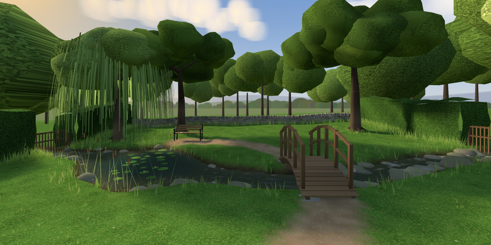

# Outside

**https://ariamokr.github.io/outside/**

A small garden outside one of the [Hallway](https://ariamokr.github.io/hallway/)'s doors, in a late
afternoon: a lawn closed in by hedges and a dry-stone wall, a stream that runs under a little
wooden foot bridge into a pond with lily pads and a willow over it, a foot trail from the door
over the bridge to a bench by the pond, and on the bench a book to read. Walk it in VR on a Meta
Quest, on a desktop or on a phone, as you walk the hallway. There is nothing to install.



Behind you as you come out is the hallway's building: its brick wall, its windows warm with the
hall's lamps, and the door you came out of, glowing, the hall seen through it. Walk back through it
(or click or tap it, or point at it in VR and pull the trigger) and you are back in the hallway,
in front of that door.

## Moving about

As in the hallway:

| | Look | Walk | Go back in | Wave (in a shared session) |
|---|---|---|---|---|
| Desktop | drag | WASD or arrows (Shift runs), Q/E or ←/→ turn, click the ground | click the door, or walk into it | the **Wave** button |
| Phone | drag | tap the ground | tap the door | the **Wave** button |
| Headset | your head | left stick walks (or aims a teleport), right stick turns, trigger at the ground teleports | trigger (or pinch) at the door, or step through it | squeeze a grip |
| Gamepad | right stick | left stick (click it in to hurry) | aim the dot at the door and press A, or walk into it | the **Wave** button |

A walk to somewhere across the water goes over the bridge, and round the pond. You can't walk
into the water, or through the hedges, the trees or the bench. The ground rises and falls a
little, and the bridge arches: you go up and down with it.

**Fullscreen**, the **control panel** on the wall beside the door (Enter or exit VR, and how to
move and turn in VR: Smooth or Teleport, Snap or Smooth), and **Together** work as they do in the
hallway. The VR choices are the hallway's own: both read and keep them in `localStorage` under
`hallway.nav` ([AriaMoKr/common](https://github.com/AriaMoKr/common)'s `nav.js`), so a choice made
on either side of the door holds on the other.

## The bench, and the book

Choose the bench (click or tap it, A on a gamepad, or the trigger in VR) to sit on it, facing the
pond and the house. On a screen you walk there first; in VR you are on it at once. Beside you lies
a book. Choose it, or **Read the book** (bottom right, on a screen), and it opens in front of you.

| | Turn a page | Put the book down | Get up |
|---|---|---|---|
| Desktop | click the page, or ← →, Space, Page Up/Down | Esc, or click off the book | WASD |
| Phone | tap the page (a page at a time, upright) | tap off the book | tap the ground |
| Headset | trigger at the page, or push the right stick left or right | B or Y | left stick |
| Gamepad | A on the page | B | left stick |

The book is *By the Water*, a little anthology: Thoreau on the pond in *Walden*'s "The Ponds"
(1854); Tennyson's "The Brook" (1855); Stevenson's "Where Go the Boats?" (1885); Hopkins's
"Inversnaid" (written 1881); Wordsworth's "I wandered lonely as a Cloud" (1815); Keats's "To
Autumn" (1820); and, to close it, Wordsworth's "The Tables Turned" ("Up! up! my Friend, and quit
your books"). All are in the public domain. Thoreau's passage is Project Gutenberg's text of
*Walden*; the poems are as Wikisource has them from the editions named in the book.

## Coming out of the hallway's door

The hallway opens a door's environment with the visit added to its address: the door contract,
in [AriaMoKr/common](https://github.com/AriaMoKr/common)'s README ("Going in", "Linking back"),
whose `door.js` the garden reads it with. It reads it once and takes it off the address, so a
reload, Back or a shared link doesn't arrive again; `room` stays.

| Parameter | What the garden does with it |
|---|---|
| `from=hallway`, `back`, `backname` | The door back leads to `back`, called the Hallway when it is the hallway's own page (or, developing, when both are on this machine). Any other address is named by its host, or by the name another hall gives itself with `backname`, cut to 24 characters on the button, the sign and the plaque. Without `back`, the door leads to the hallway anyway, at `?from=outside`: this garden is outside its door, however one got here. The way back lasts the tab (`sessionStorage`). |
| `dx`, `yaw`, `pitch` | You come out where you went in (`dx` across the doorway), turned and looking as you were. Facing straight in, through the hallway's doorway, you see the garden's picture; coming out, you see the garden from where that picture was taken. |
| `dw`, `dh`, `glow` | The door back is that wide and high, and glows in that colour. |
| `room` | You stay in the shared session (below); the door back carries it on. |

Walking out of the hallway's VR, Quest Browser can hand this page the immersive session without a
click (`sessiongranted`): the garden listens for it from the first script on the page and takes
it at once, so you stay in VR, as long as both are on `ariamokr.github.io`.

Through the door back you see the hall: the view the hallway publishes out of its door to here
(`views/views.json` beside the hallway, under this garden's id, `outside`; common's README, "The
view from your door"). When that can't be had, the doorway shows this site's own copy, rendered
from the hallway (`public/views/`, below). When the way back is not the hallway, the doorway shows
its glow and the place's name.

## The door in the hallway

The hallway's fourth door, on the right across from the Music Room under a "Garden" sign, opens
here. Its entry in the hallway's
[`public/js/environments.js`](https://github.com/AriaMoKr/hallway/blob/main/public/js/environments.js)
is the same as `HALLWAY_DOOR` in [`public/js/way.js`](public/js/way.js):

```js
{
  id: 'outside',
  title: 'outside',
  subtitle: "A small garden outside one of the hallway's doors: a lawn, a stream and a pond, a foot bridge, and a bench to sit and read on. Walk it in VR on a Meta Quest, on a desktop or on a phone.",
  sign: 'Garden',
  url: 'https://ariamokr.github.io/outside/',
  preview: 'https://ariamokr.github.io/outside/hallway-preview.jpg',
  color: '#9fd07a',
},
```

As the hallway's README asks ("Adding a door"), the title on the plaque beside the door is this
repository's name, and the subtitle under it is this page's description (its `<meta
name="description">`) word for word; a test checks that they match. When the description changes,
change the subtitle with it, here and in the hallway. The hallway's `views.json` has `outside`, so
the door back here shows the hall from the hallway's own picture.

## Together

The hallway's shared session ([AriaMoKr/layersharedsession](https://github.com/AriaMoKr/layersharedsession),
peer to peer over WebRTC) comes out here too: this is the first place behind a door to take part.
Come out of the hallway in a session and you join the same room here, as `outside`. The others
out here are drawn by the layer's `avatars.js`, as in the hallway: a head with a visor, their hands
in VR, a ring on the ground (on the water, where they stand at its very edge) and their name.
Waving is as in the hallway. The **Wave** button at the bottom right, or a controller's grip in VR
(it pulses, so you feel it go out), waves to everyone in the session: they get a toast saying you
waved, and those out here see your avatar bob. A wave from anyone else, here or in the hallway, is
a toast here too, and bobs their avatar when they are out here. The panel's **Start shared
session** starts one here, and **Copy invite link** copies its address. The door back carries the
room into the hallway. In the hallway, those out here count as elsewhere.

## Running it

You need Node.js 22 or newer.

```bash
npm install     # three.js, common (the door contract), the shared-session layer and Trystero (and IWER, for emulating a headset), copied into public/vendor/
npm start       # http://localhost:8090/
npm test
```

`public/` is the whole site: any static server can serve it once `npm install` has filled
`public/vendor/`. `?xr=emulate` installs Meta's IWER emulator (a virtual Quest 3). For a Quest over
adb, `adb reverse tcp:8090 tcp:8090` and start the server on IPv4 (`npm start -- --host 127.0.0.1`),
as for the hallway.

To try the way in and out locally, serve the hallway's checkout as well (on 8088), and open the
garden as its door would:

```
http://localhost:8090/?from=hallway&back=http%3A%2F%2Flocalhost%3A8088%2F%3Ffrom%3Doutside&dx=0.2&yaw=-15&pitch=-5&dw=1.1&dh=2.25&glow=9fd07a
```

The hallway's dev server sends no CORS headers (GitHub Pages does), so locally the door back shows
this site's copy of the view rather than the hallway's.

## The pictures either side of the door

Two pictures are rendered in headless Chrome and committed:

```bash
node tools/preview.mjs        # public/hallway-preview.jpg: the garden, for the hallway's doorway here and a shared link's preview
node tools/hallway-view.mjs   # public/views/: the hall, for the doorway back (needs an installed hallway checkout; --hallway <path>, default ../hallway)
```

Render the first again after changing the garden, and the second after the hallway changes. The
hallway checkout is copied, never changed. Each run starts Chrome on a new profile that is first
told the Windows password is not blank (as Breadboard's tools do), so Chrome never tries a logon
to find out.

## Publishing

`.github/workflows/pages.yml` publishes `public/` to GitHub Pages
(https://ariamokr.github.io/outside/, from AriaMoKr/outside) on every push to `main`, after the
tests. In the repository's Settings → Pages, the source must be "GitHub Actions". Every URL in the
page is relative.
